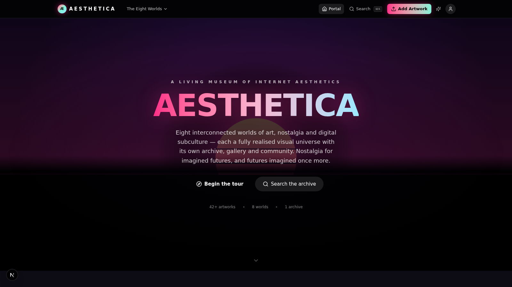
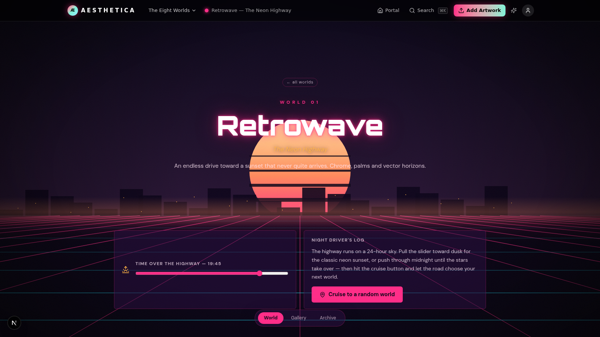
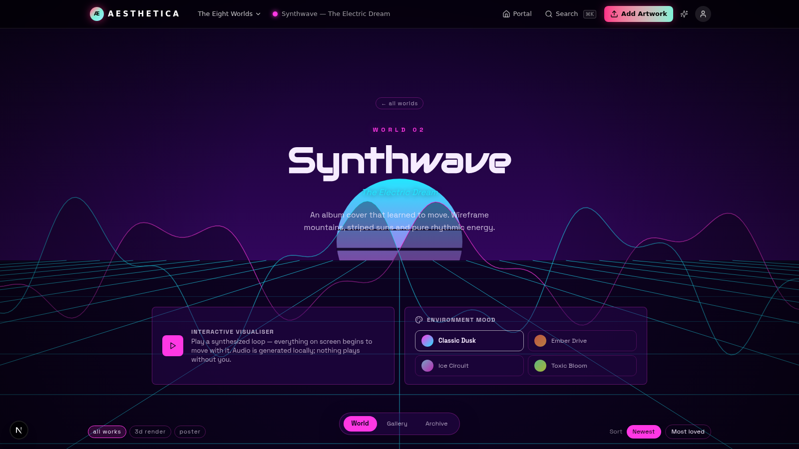
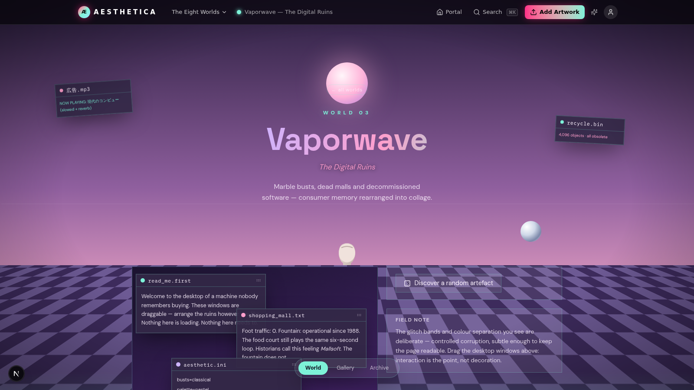
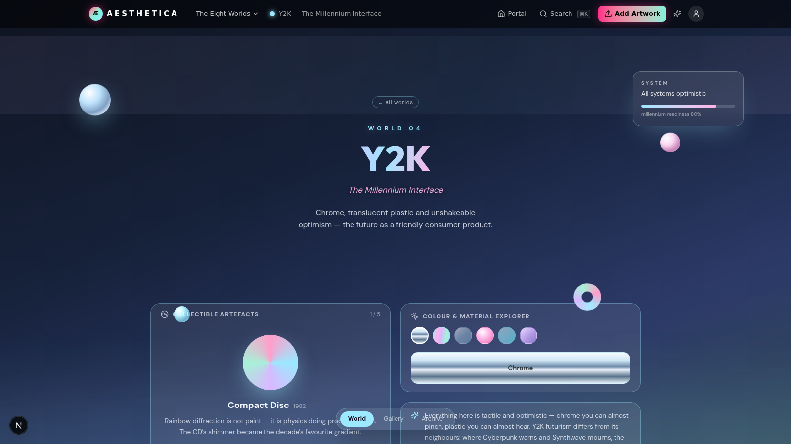
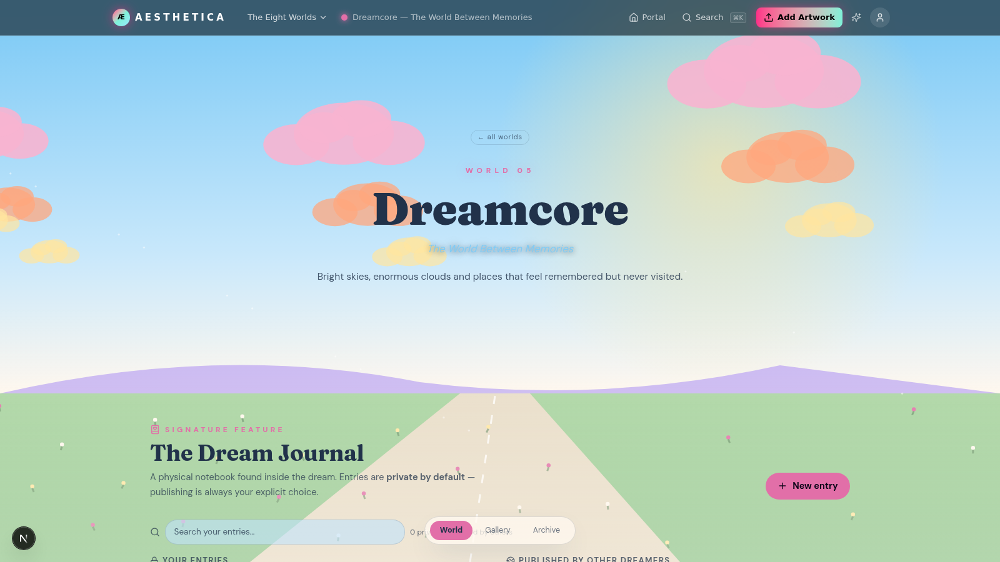
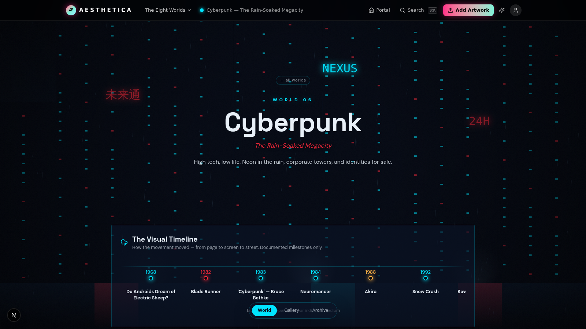
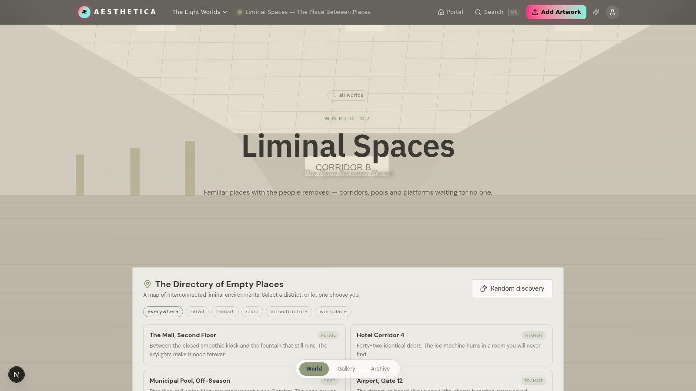
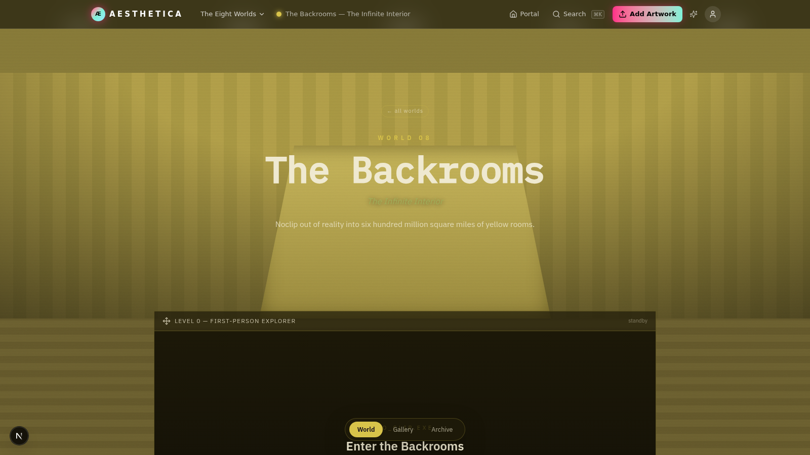

<div align="center">

# Æ AESTHETICA

**A Living Museum of Internet Aesthetics**

Eight interconnected worlds of art, nostalgia and digital subculture — each a fully
realised visual universe with its own archive, gallery and community.
*Nostalgia for imagined futures, and futures imagined once more.*



</div>

## The Eight Worlds

Each world has a living canvas environment, a signature interactive experience, a real
community gallery (like / bookmark / comment / upload), and a historical archive that
carefully separates **documented facts** from **interpretation**.

| # | World | Epithet | Signature experience |
|---|-------|---------|----------------------|
| 01 | **Retrowave** | The Neon Highway | Perspective-grid canvas with a 24-hour sunset slider and a "cruise" through random worlds |
| 02 | **Synthwave** | The Electric Dream | Wireframe terrain + WebAudio synth-loop visualizer, audio-reactive, 4 color moods |
| 03 | **Vaporwave** | The Digital Ruins | Draggable retro desktop windows, rotating bust, checkerboard ruins, hidden artefacts |
| 04 | **Y2K** | The Millennium Interface | Chrome orbs, collectible artefact carousel, material explorer |
| 05 | **Dreamcore** | The World Between Memories | Living meadow, **Dream Journal** (private-by-default, shareable via link), postcards, memory fragments, Cloud Atlas, Sleepy Radio |
| 06 | **Cyberpunk** | The Rain-Soaked Megacity | Three-plane rain canvas, expandable visual timeline 1968 → today |
| 07 | **Liminal Spaces** | The Place Between Places | Slow-drift corridor, location directory with type filters + random discovery |
| 08 | **The Backrooms** | The Infinite Interior | **First-person raycaster maze** (WASD + touch), Radio Room with synthesized stations, Found Notes, Level Explorer |

<div align="center">
<table>
<tr>
<td align="center" width="50%"><br/><sub><b>01 · Retrowave</b> — The Neon Highway</sub></td>
<td align="center" width="50%"><br/><sub><b>02 · Synthwave</b> — The Electric Dream</sub></td>
</tr>
<tr>
<td align="center"><br/><sub><b>03 · Vaporwave</b> — The Digital Ruins</sub></td>
<td align="center"><br/><sub><b>04 · Y2K</b> — The Millennium Interface</sub></td>
</tr>
<tr>
<td align="center"><br/><sub><b>05 · Dreamcore</b> — The World Between Memories</sub></td>
<td align="center"><br/><sub><b>06 · Cyberpunk</b> — The Rain-Soaked Megacity</sub></td>
</tr>
<tr>
<td align="center"><br/><sub><b>07 · Liminal Spaces</b> — The Place Between Places</sub></td>
<td align="center"><br/><sub><b>08 · The Backrooms</b> — The Infinite Interior</sub></td>
</tr>
</table>
</div>

## Features

- **Real community, real data** — likes, bookmarks, comments, uploads (client-side
  canvas compression → data URL → SQLite), tag search, full-text search overlay (⌘K)
- **Anonymous device identity** — no signup; a UUID + display name lives in
  `localStorage` and authorizes your actions server-side
- **Dream Journal** with privacy by default — entries stay yours until you generate a
  share link; the share surface only ever exposes published entries
- **Honest archives** — every world's history section separates documented events
  (dated, sourced) from interpretive curation
- **Living canvases everywhere** — hand-written 2D-canvas scenes (grids, terrain,
  rain, corridors, raycaster), DPR-aware, paused when the tab hides
- **Accessibility** — `prefers-reduced-motion` respected globally plus a manual FX
  toggle in the nav; keyboard navigable; semantic landmarks
- **Single-page architecture** — one route, hash-routed views, deep-linkable
  (`#/world/vaporwave`, `#/artwork/…`, `#/shared/…`)

## Tech Stack

[Next.js 16](https://nextjs.org) (App Router, standalone output) · TypeScript ·
Tailwind CSS 4 · shadcn/ui · [Prisma](https://prisma.io) + SQLite · zustand ·
next/font (9 typefaces) · hand-rolled Canvas 2D + WebAudio

## Run Locally

```bash
git clone https://github.com/lewiskerrlk110-hue/aesthetica.git
cd aesthetica
bun install                 # or npm install
cp .env.example .env        # points Prisma at db/custom.db
bun run db:generate         # prisma generate (also runs on postinstall)
bun run dev                 # http://localhost:3000
```

The database ships pre-seeded (41 artworks, backrooms levels & notes, postcards,
cloud atlas, memory fragments). To re-seed from scratch: `bun scripts/seed.ts`
(idempotent). Requires [Bun](https://bun.sh) for scripts; Node ≥ 20 for the app.

## Deploy to Vercel

[](https://vercel.com/new/clone?repository-url=https%3A%2F%2Fgithub.com%2Flewiskerrlk110-hue%2Faesthetica&env=DATABASE_URL&project-name=aesthetica)

1. Import the repo at [vercel.com/new](https://vercel.com/new)
2. Add the environment variable:
   `DATABASE_URL` = `file:../db/custom.db`
3. Deploy — `postinstall` runs `prisma generate` automatically

> **⚠️ Persistence note:** SQLite lives in the deployment bundle. On Vercel, reads
> (galleries, archives, seed content) work fully, but **writes are ephemeral** —
> serverless instances don't share a filesystem, so new uploads/likes vanish on the
> next invocation. For fully persistent community features, swap the Prisma
> datasource to a hosted database (e.g. [Turso](https://turso.tech) for
> SQLite-compatible serverless, or Neon/Supabase Postgres) — the schema ports
> almost 1:1. Run locally for the complete experience.

## Project Structure

```
src/
  lib/aesthetics.ts      ← single source of truth: 8 worlds, colors, archives
  lib/store.ts           ← hash router (SPA on one route)
  app/globals.css        ← per-world theme scopes ([data-world]), keyframes, FX
  components/worlds/     ← one interactive component per world
  components/gallery/    ← cards, viewer, upload, search
  components/homepage/   ← morphing hero canvas, portal cards
  app/api/               ← artworks · likes · bookmarks · comments · journal ·
                            fragments · dreamseed · stats
db/custom.db             ← pre-seeded SQLite database
scripts/                 ← seed.ts (idempotent) · gen-images.mjs (AI artworks)
```

`HANDOFF.md` is a complete architecture primer; `worklog.md` holds the full build log.

## Credits

All 24 gallery artworks were AI-generated for this project; SVG fallback pieces were
hand-coded. Historical claims in the archives are labelled documented vs. interpretive
and reference real events (e.g. the Backrooms' 2019 origin thread, vaporwave's
2010–2013 formative releases, DeadMalls.com). AESTHETICA is a fan-curated museum of
internet culture, not affiliated with any of the referenced works or communities.
